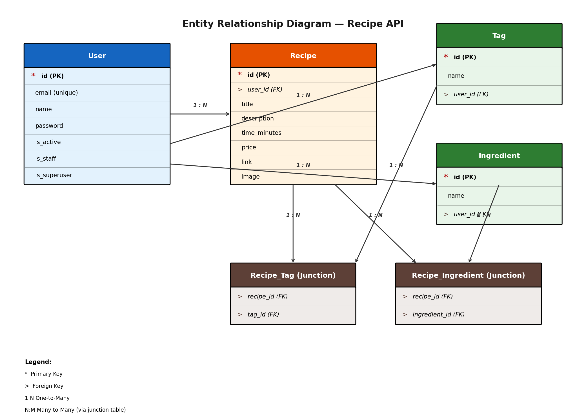

# Recipe API

A production-ready Django REST Framework API for managing recipes, built with Docker, PostgreSQL, and Nginx. Features custom user authentication, recipe CRUD with tags and ingredients, image uploads, and OpenAPI/Swagger documentation.

---

## Table of Contents

- [Architecture Overview](#architecture-overview)
- [Entity Relationship Diagram](#entity-relationship-diagram)
- [Tech Stack](#tech-stack)
- [Prerequisites](#prerequisites)
- [Project Structure](#project-structure)
- [Quick Start (Development)](#quick-start-development)
- [Production Deployment](#production-deployment)
- [API Endpoints](#api-endpoints)
- [Environment Variables](#environment-variables)
- [Authentication](#authentication)
- [Image Uploads](#image-uploads)
- [Running Tests](#running-tests)
- [Troubleshooting](#troubleshooting)

---


- **Nginx** serves as a reverse proxy and serves static/media files
- **uWSGI** runs the Django WSGI application
- **PostgreSQL** persists all application data
- **Django REST Framework** handles the API layer

---

## Entity Relationship Diagram



### Relationships

| Relationship | Type | Description |
|-------------|------|-------------|
| `User → Recipe` | 1:N | A user can create many recipes |
| `User → Tag` | 1:N | A user can create many tags |
| `User → Ingredient` | 1:N | A user can create many ingredients |
| `Recipe ↔ Tag` | N:M | Recipes can have multiple tags; tags can belong to multiple recipes (via `Recipe_Tag` junction table) |
| `Recipe ↔ Ingredient` | N:M | Recipes can have multiple ingredients; ingredients can belong to multiple recipes (via `Recipe_Ingredient` junction table) |

---

## Tech Stack

| Layer | Technology |
|-------|-----------|
| Backend | Python 3.9, Django 4.x, Django REST Framework |
| Database | PostgreSQL 13 (Alpine) |
| Web Server | Nginx (unprivileged) |
| WSGI Server | uWSGI |
| Containerization | Docker & Docker Compose |
| API Documentation | drf-spectacular (OpenAPI 3.0 / Swagger) |
| Authentication | Token Authentication (DRF) |
| Image Handling | Pillow |

---

## Prerequisites

- [Docker](https://docs.docker.com/get-docker/) (v20.10+)
- [Docker Compose](https://docs.docker.com/compose/install/) (v2.0+)
- Make (optional, for convenience commands)

---

## Project Structure

```
recipe-app-api/
├── app/                          # Django application code
│   ├── app/                      # Project settings
│   │   ├── __init__.py
│   │   ├── settings.py
│   │   ├── urls.py
│   │   └── wsgi.py
│   ├── core/                     # Core models & management commands
│   │   ├── __init__.py
│   │   ├── models.py             # User, Recipe, Tag, Ingredient models
│   │   ├── management/
│   │   │   └── commands/
│   │   │       └── wait_for_db.py
│   │   └── tests/
│   ├── user/                     # User API (auth, registration, profile)
│   │   ├── serializers.py
│   │   ├── views.py
│   │   ├── urls.py
│   │   └── tests/
│   ├── recipe/                   # Recipe API (CRUD, tags, ingredients, images)
│   │   ├── serializers.py
│   │   ├── views.py
│   │   ├── urls.py
│   │   └── tests/
│   └── manage.py
├── proxy/                        # Nginx reverse proxy
│   ├── Dockerfile
│   ├── default.conf.tpl          # Nginx config template
│   ├── uwsgi_params
│   └── run.sh
├── scripts/                      # Utility scripts
│   └── run.sh                    # App entrypoint script
├── docker-compose.yml            # Development orchestration
├── docker-compose-deploy.yml     # Production orchestration
├── Dockerfile                    # App Docker image
├── requirements.txt              # Production dependencies
├── requirements.dev.txt          # Development dependencies
└── README.md                     # This file
```

---

## Quick Start (Development)

### 1. Clone the Repository

```bash
git clone <repository-url>
cd recipe-app-api
```

### 2. Build and Start the Development Environment

```bash
docker-compose up --build
```

This command will:
- Build the Django app image (with dev dependencies)
- Start a PostgreSQL container
- Run database migrations automatically
- Start the Django development server on `http://localhost:8000`

> **Note:** The first build may take a few minutes as it installs system dependencies (PostgreSQL client, JPEG libraries, etc.) and Python packages.

### 3. Create a Superuser (Optional)

```bash
docker-compose exec app sh -c "python manage.py createsuperuser"
```

### 4. Access the Application

| Service | URL |
|---------|-----|
| API Root | http://localhost:8000/api/ |
| Admin Panel | http://localhost:8000/admin/ |
| API Docs (Swagger) | http://localhost:8000/api/docs/ |
| Health Check | http://localhost:8000/api/health-check/ |

### 5. Stop the Environment

```bash
docker-compose down
```

To also remove the database volume:

```bash
docker-compose down -v
```

---

## Production Deployment

### 1. Create Environment Variables

Create a `.env` file in the project root:

```env
DB_NAME=proddb
DB_USER=produser
DB_PASS=your-secure-password
DJANGO_SECRET_KEY=your-very-long-secret-key-here
DJANGO_ALLOWED_HOSTS=your-domain.com,www.your-domain.com
```

> **Generate a secret key:**
> ```bash
> python -c "import secrets; print(secrets.token_urlsafe(50))"
> ```

### 2. Build and Deploy

```bash
docker-compose -f docker-compose-deploy.yml up --build -d
```

### 3. Production Architecture

```
Client ──▶ Nginx (port 8000) ──▶ uWSGI (socket :9000) ──▶ Django App
                                    │
                                    └──▶ PostgreSQL
```

- **Nginx** handles static files, media files, and reverse-proxies to uWSGI
- **uWSGI** runs with 4 workers and master process for reliability
- **Static files** are collected to `/vol/static` and served by Nginx
- **Media uploads** are stored in `/vol/web/media`

---

## API Endpoints

### Authentication

| Method | Endpoint | Description |
|--------|----------|-------------|
| `POST` | `/api/user/create/` | Register a new user |
| `POST` | `/api/user/token/` | Obtain auth token |
| `GET` | `/api/user/me/` | Get current user profile |
| `PUT` | `/api/user/me/` | Update user profile |

### Recipes

| Method | Endpoint | Description |
|--------|----------|-------------|
| `GET` | `/api/recipe/recipes/` | List all recipes (with optional filters) |
| `POST` | `/api/recipe/recipes/` | Create a new recipe |
| `GET` | `/api/recipe/recipes/{id}/` | Retrieve a specific recipe |
| `PUT` | `/api/recipe/recipes/{id}/` | Update a recipe |
| `PATCH` | `/api/recipe/recipes/{id}/` | Partially update a recipe |
| `DELETE` | `/api/recipe/recipes/{id}/` | Delete a recipe |
| `POST` | `/api/recipe/recipes/{id}/upload-image/` | Upload an image to a recipe |

### Tags & Ingredients

| Method | Endpoint | Description |
|--------|----------|-------------|
| `GET` | `/api/recipe/tags/` | List tags |
| `PUT` | `/api/recipe/tags/{id}/` | Update a tag |
| `DELETE` | `/api/recipe/tags/{id}/` | Delete a tag |
| `GET` | `/api/recipe/ingredients/` | List ingredients |
| `PUT` | `/api/recipe/ingredients/{id}/` | Update an ingredient |
| `DELETE` | `/api/recipe/ingredients/{id}/` | Delete an ingredient |

### Query Parameters

**Recipes:**
- `?tags=1,2,3` — Filter by comma-separated tag IDs
- `?ingredients=1,2` — Filter by comma-separated ingredient IDs

**Tags & Ingredients:**
- `?assigned_only=1` — Show only items assigned to at least one recipe

---

## Environment Variables

### Development (`docker-compose.yml`)

| Variable | Default | Description |
|----------|---------|-------------|
| `DB_HOST` | `db` | PostgreSQL hostname |
| `DB_NAME` | `devdb` | Database name |
| `DB_USER` | `devuser` | Database user |
| `DB_PASS` | `changeme` | Database password |
| `DEBUG` | `1` | Django debug mode |

### Production (`docker-compose-deploy.yml`)

| Variable | Required | Description |
|----------|----------|-------------|
| `DB_NAME` | Yes | Database name |
| `DB_USER` | Yes | Database user |
| `DB_PASS` | Yes | Database password |
| `DJANGO_SECRET_KEY` | Yes | Django secret key (50+ chars) |
| `DJANGO_ALLOWED_HOSTS` | Yes | Comma-separated allowed hosts |

---

## Authentication

This API uses **Token Authentication** via Django REST Framework.

### 1. Create a User

```bash
curl -X POST http://localhost:8000/api/user/create/ \
  -H "Content-Type: application/json" \
  -d '{"email": "user@example.com", "password": "password123", "name": "John Doe"}'
```

### 2. Obtain a Token

```bash
curl -X POST http://localhost:8000/api/user/token/ \
  -H "Content-Type: application/json" \
  -d '{"email": "user@example.com", "password": "password123"}'
```

**Response:**
```json
{"token": "abc123def456..."}
```

### 3. Use the Token

Include the token in the `Authorization` header for all subsequent requests:

```bash
curl -X GET http://localhost:8000/api/recipe/recipes/ \
  -H "Authorization: Token abc123def456..."
```

---

## Image Uploads

Recipes support image uploads via a dedicated endpoint:

```bash
curl -X POST http://localhost:8000/api/recipe/recipes/1/upload-image/ \
  -H "Authorization: Token abc123def456..." \
  -H "Content-Type: multipart/form-data" \
  -F "image=@/path/to/your/image.jpg"
```

**Features:**
- Images are stored with UUID-based filenames to prevent collisions
- Original file extensions are preserved
- Files are saved to `/vol/web/media/uploads/recipe/`
- Supported formats depend on Pillow build (typically JPEG, PNG, GIF, WEBP)

---

## Running Tests

### Run All Tests

```bash
docker-compose exec app sh -c "python manage.py test"
```

### Run Tests with Coverage

```bash
docker-compose exec app sh -c "coverage run --source='.' manage.py test && coverage report"
```

### Run Specific Test Module

```bash
docker-compose exec app sh -c "python manage.py test core.tests.test_models"
```

### Run Tests in Watch Mode (Development)

```bash
docker-compose exec app sh -c "ptw -- --testrunner app.test_runner.NoDbTestRunner"
```

---

## Troubleshooting

### Port Already in Use

If port `8000` is already taken, modify the port mapping in `docker-compose.yml`:

```yaml
ports:
  - "8080:8000"
```

### Database Connection Refused

The `wait_for_db` command handles this automatically, but if migrations fail:

```bash
docker-compose exec app sh -c "python manage.py wait_for_db && python manage.py migrate"
```

### Static Files Not Loading (Production)

Ensure the static volume is properly mounted and `collectstatic` ran:

```bash
docker-compose -f docker-compose-deploy.yml exec app sh -c "python manage.py collectstatic --noinput"
```

### Permission Denied on Media Uploads

The Dockerfile creates the `/vol/web` directory with proper permissions for the `django-user`. If you encounter issues:

```bash
docker-compose exec app sh -c "chown -R django-user:django-user /vol/web"
```

### Rebuild from Scratch

```bash
docker-compose down -v
docker-compose up --build
```

---

## Development Notes

### Adding a New Dependency

1. Add the package to `requirements.txt` (production) or `requirements.dev.txt` (development)
2. Rebuild the image:
   ```bash
   docker-compose up --build
   ```

### Database Migrations

After changing models, create and run migrations:

```bash
docker-compose exec app sh -c "python manage.py makemigrations"
docker-compose exec app sh -c "python manage.py migrate"
```

### Accessing the Django Shell

```bash
docker-compose exec app sh -c "python manage.py shell"
```

### Viewing Logs

```bash
docker-compose logs -f app
```

---

## License

This project is for educational and personal use.

---

## Author
**Lebogang Modike**

Built with Django REST Framework, Docker, and PostgreSQL.
